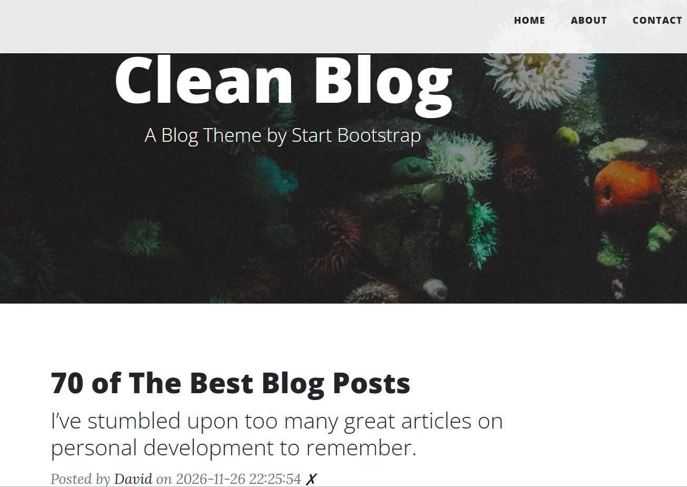
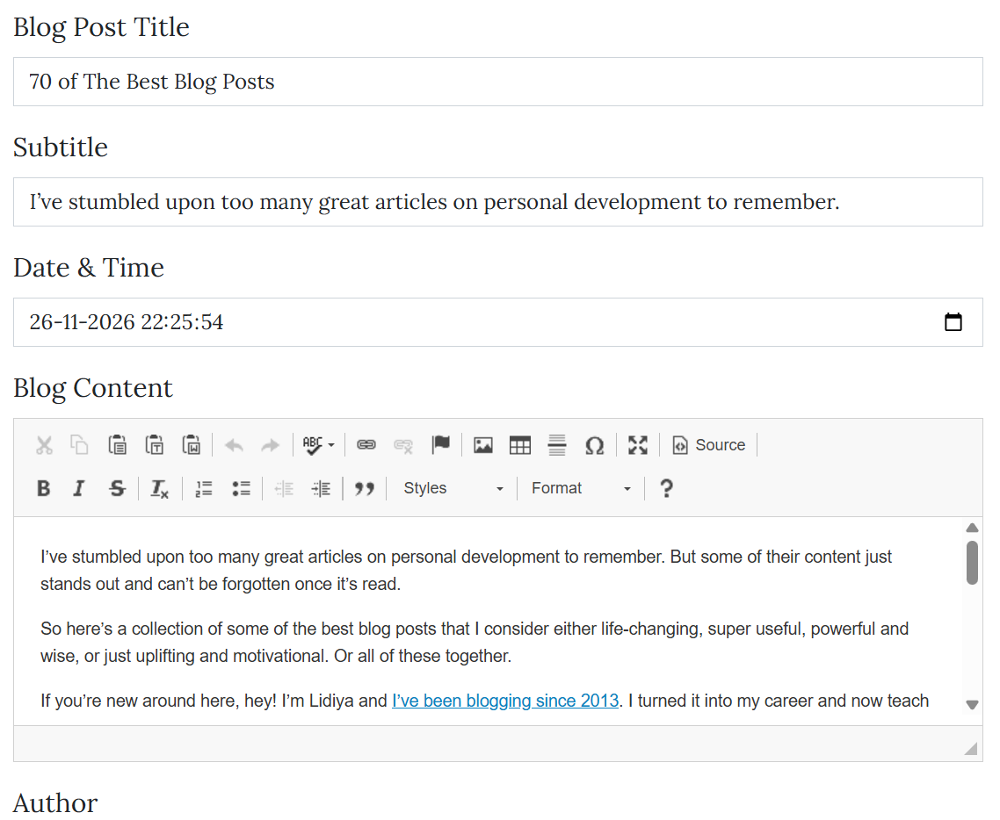
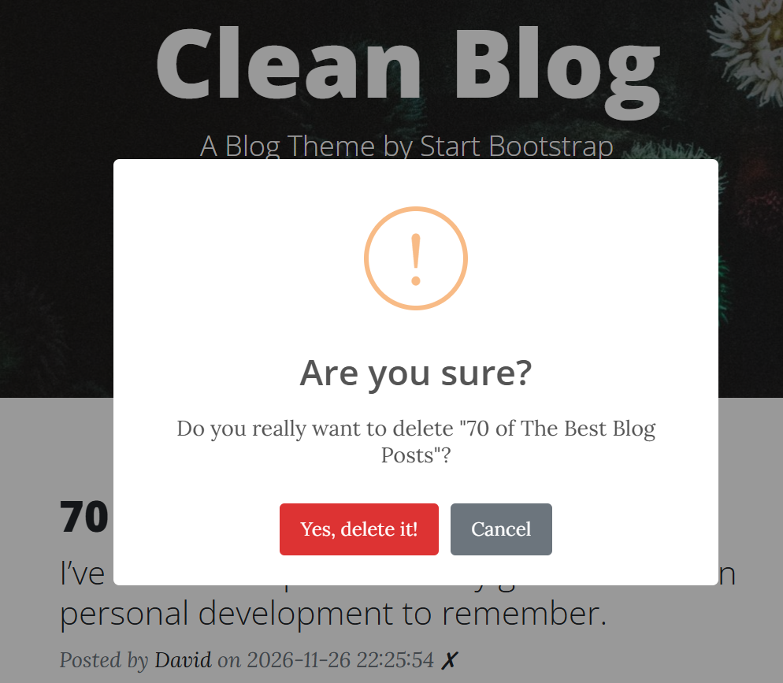

# ✍️ InkFlow — Full-Stack RESTful Blog Web App

A full-stack blog platform built with **Python**, **Flask**, **SQLAlchemy 2.0**, and **MySQL** that enables writers to create, publish, edit, paginate, and manage rich-text blog posts with an intuitive WYSIWYG editor and responsive Bootstrap 5 UI.

The goal of this project is to demonstrate end-to-end full-stack web development using RESTful routing conventions, relational database persistence, rich-text HTML sanitization, and polished frontend UX enhancements.

---

## 🚀 Technologies Used

- **Backend:** Python 3, Flask, SQLAlchemy 2.0 (`Flask-SQLAlchemy`)
- **Database:** MySQL (`PyMySQL`, `cryptography`)
- **Frontend:** HTML5, CSS3, Bootstrap 5 (`Bootstrap-Flask`), Jinja2
- **Rich-Text Editor:** `Flask-CKEditor` (WYSIWYG formatting), `bleach` (HTML sanitization)
- **Forms & Validation:** Flask-WTF, WTForms (`DateTimeField` with `DateTimeLocalInput`)
- **UI/UX Enhancements:** SweetAlert2, Full-Screen Loading Overlay, Server-Side Pagination
- **Configuration & Version Control:** `python-dotenv`, Git & GitHub

---

## 📌 Project Architecture

```text
Browser (Bootstrap 5 + CKEditor + SweetAlert2 + Loader UI)
      │
      ▼  RESTful HTTP Requests (GET / POST)
Flask Application (main.py + Flask-WTF Validation)
      │
      ▼  SQLAlchemy 2.0 ORM + PyMySQL Driver
MySQL Database (blog_db -> posts table)
```

---

## ✨ Key Functionality

- **Full RESTful CRUD Operations:**
  - **Read All (`/`):** Queries MySQL, orders posts chronologically (`DESC`), and renders paginated post previews (`db.paginate`) with **Newer Posts** and **Older Posts** navigation.
  - **Read Single (`/post/<int:post_id>`):** Displays the full article, hero cover image, author metadata, publication timestamp, and safely rendered rich-text HTML body (`| safe`).
  - **Create (`/new-post`):** Compose new blog posts using a rich-text **CKEditor** toolbar and an integrated **Date & Time** calendar/clock picker (`YYYY-MM-DD HH:MM:SS`).
  - **Update (`/edit-post/<int:post_id>`):** Dynamically switches the form header to the post's title and cover image while pre-populating existing post data (`obj=post_data`) for seamless editing.
  - **Delete (`/delete/<int:post_id>`):** Removes posts from MySQL after user confirmation.
- **Interactive UI & UX:**
  - **SweetAlert2 Confirmation Modal:** Prompts users with the exact post title before deleting an article.
  - **Full-Screen Loading Overlay:** Provides immediate visual feedback (`Saving data...` / `Deleting post...`) during form submissions and database operations.
  - **Server-Side Pagination:** Efficiently loads posts per page using SQL `LIMIT` and `OFFSET` via `db.paginate()`.

---

## 📂 Project Structure

```text
python-blog-restful-api/
├── static/
│   ├── assets/
│   │   ├── favicon.ico
│   │   └── img/             # Header cover images (home, post, edit, about, contact)
│   ├── css/
│   │   └── styles.css       # Clean Blog Bootstrap 5 theme styling
│   └── js/
│       └── scripts.js       # Theme navigation & scroll behavior
├── templates/
│   ├── header.html          # Head metadata, Bootstrap 5, SweetAlert2 & Loader overlay
│   ├── footer.html          # Footer, Bootstrap JS, Loader & SweetAlert2 delete handler
│   ├── index.html           # Paginated blog feed with delete triggers
│   ├── post.html            # Full single-post reading view with Edit Post button
│   ├── make-post.html       # Shared Create / Edit post form with CKEditor
│   ├── about.html           # About page
│   └── contact.html         # Contact page
├── .env                     # Database & Flask secret credentials (ignored by Git)
├── .gitignore               # Excludes .env, venv/, and __pycache__/
├── main.py                  # Flask routes, SQLAlchemy models & WTForms
├── requirements.txt         # Project dependencies
└── README.md                # Project documentation
```

---

## ⚙️ Prerequisites

Before running this project locally, ensure you have installed:

1. **Python 3.10+**
2. **MySQL Server** (MySQL Workbench, XAMPP, or WAMP)
3. **Git**

Verify Python installation:
```bash
python --version
```

---

## 🛠️ Local Setup & Installation

### 1. Clone the Repository
```bash
https://github.com/sanjay-karmakar/python-blog-RESTful-API.git
cd python-blog-restful-api
```

### 2. Create & Activate a Virtual Environment
```bash
# Windows
python -m venv venv
.\venv\Scripts\activate

# macOS / Linux
python3 -m venv venv
source venv/bin/activate
```

### 3. Install Required Packages
```bash
# Windows users use:
python -m pip install -r requirements.txt

# Mac / Linux users use:
pip3 install -r requirements.txt
```

*(Core packages installed: `Flask`, `Flask-SQLAlchemy`, `PyMySQL`, `cryptography`, `Flask-WTF`, `WTForms`, `Bootstrap-Flask`, `Flask-CKEditor`, `bleach`, `python-dotenv`)*

### 4. Create the MySQL Database
Open MySQL Workbench, phpMyAdmin, or your MySQL CLI and create an empty database (SQLAlchemy will automatically generate the `posts` table on startup):
```sql
CREATE DATABASE python_blog_db;
```

### 5. Configure Environment Variables (`.env`)
Create a `.env` file in the root directory and add your Flask secret key and MySQL credentials:
```env
SECRET_KEY=your_secret_flask_key
DB_USER=root
DB_PASSWORD=your_mysql_password
DB_HOST=localhost
DB_NAME=python_blog_db
```

**Security:** Never upload your `.env` file or database passwords to GitHub.

### 6. Run the Application
```bash
python main.py
```
Open your browser and navigate to **`http://127.0.0.1:5000`**.

---

## 📸 Screenshots

> *Add screenshots of your Home Feed, CKEditor Post Creator, and SweetAlert2 Delete Confirmation inside a `screenshots/` folder and link them below:*
> ```markdown
> 
> 
> 
> ```

---

## 🔒 `.gitignore`

Ensure the following files and folders are excluded from Git commits:
```text
venv/
__pycache__/
*.pyc
.env
.idea/
```

---

## 🧠 What I Learned

Through building this project, I practiced:
- Architecting **RESTful routing** in **Flask** (`/`, `/post/<id>`, `/new-post`, `/edit-post/<id>`, `/delete/<id>`)
- Integrating **SQLAlchemy 2.0** (`Mapped` and `mapped_column`) with **MySQL** via **PyMySQL**
- Implementing efficient server-side **pagination** using `db.paginate()`
- Integrating **Flask-CKEditor** for rich-text content creation and safely rendering HTML in Jinja2
- Handling **Date & Time** input widgets (`DateTimeField` + `DateTimeLocalInput`) and standardized timestamp formatting (`YYYY-MM-DD HH:MM:SS`)
- Building polished user interactions with **Bootstrap 5**, **SweetAlert2** confirmation dialogs, and full-screen loading spinners

---

## 🔄 Future Improvements

- Add **User Authentication & Role-Based Access** (`Flask-Login` & password hashing) so only authenticated authors can create, edit, or delete posts
- Implement a **Comments Section** with a one-to-many relational table (`User` -> `BlogPost` -> `Comment`)
- Add **Tagging & Search Filtering** to filter posts by category or keyword
- Deploy the application to a cloud platform (Render / Railway / AWS EC2) with a managed MySQL database

---

## 👨‍💻 Author

**Sanjay Karmakar**

Full-Stack Python & Flask Developer

- GitHub: [@sanjay-karmakar](https://github.com/sanjay-karmakar)
- LinkedIn: [Connect with me on LinkedIn](https://www.linkedin.com/in/sanjay-karmakar-a05827163)

### 📌 Tagline
*Turning ideas into clean, interactive full-stack web applications.*